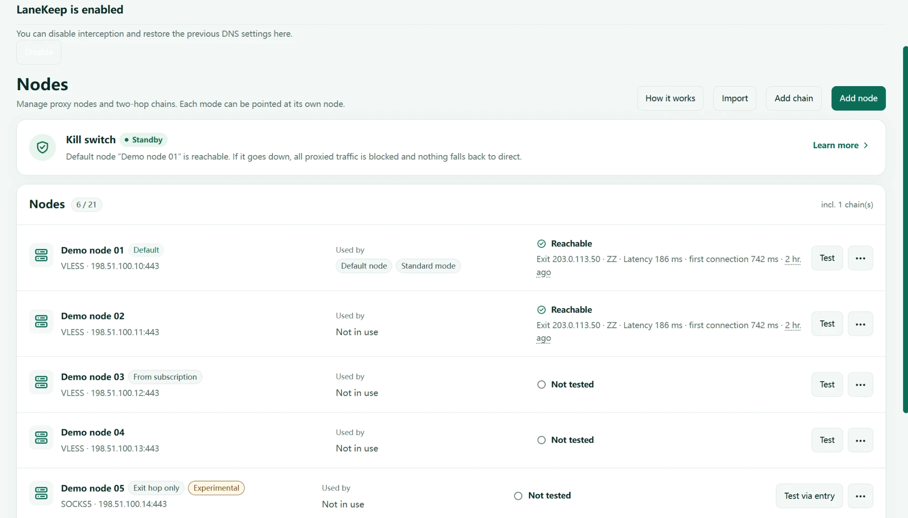
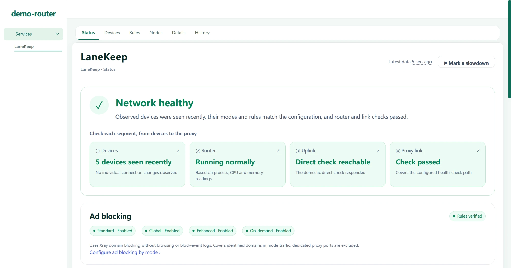
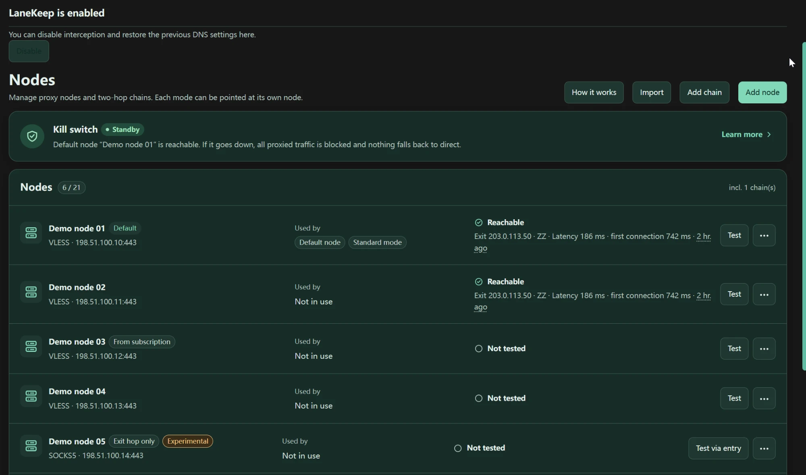

# LaneKeep

[中文](README.md) · [Leak protection](docs/leak-protection.en.md) · [Advanced notes](docs/notes.en.md)

A per-device routing panel for OpenWrt, with node management, controlled DNS paths and a proxy kill switch.

**v0.2.1 is disabled on first installation. Installing it, adding nodes and saving settings do not activate interception.** Select a default node, then separately confirm **Enable LaneKeep** on the Nodes page.

0.2.1 fixes the kill switch always showing “Unknown” on the Nodes page and the English Status page title; 0.2.0 added IP rules, reworked Rules/Details/Devices/History pages and node latency measurement v3; see the [CHANGELOG](CHANGELOG.md). Upgrade from 0.2.0 or 0.1.0 with `apk add --upgrade` (acceptance covers only disabled instances: 0.2.1 was upgraded from 0.2.0, 0.2.0 from 0.1.0; see the [acceptance limits](docs/audit/v0.2.1/acceptance.md#验证边界)); before downgrading to 0.1.0, delete all IP rules.



## Features

| Mode | Factory presets | Unmatched traffic |
|---|---|---|
| Standard, used by unassigned devices | Known foreign categories via proxy; domestic categories direct | Direct |
| Global | Private names and addresses direct; other traffic via proxy, subject to custom exceptions | Proxy |
| Enhanced | Foreign and selected service categories via proxy; domestic categories direct | Proxy |
| On-demand | Selected video and service categories via proxy; add other domains as needed | Direct |

Factory defaults contain no nodes, assigned devices, custom rules or FakeIP exceptions. Classification depends on the installed databases; it does not identify every site's location. Custom rules run at the insertion points shown on the Rules page, after fixed protection and some private-address rules.

- A proxy node per mode, inheriting the default when unset. Shared DNS and the kill switch still follow the default node.
- Domain, exact-domain, keyword, public IPv4 address / network and the fixed ad-domain category; direct, proxy, specific-node or block actions. Ad blocking starts disabled and can be added per mode. IP rules match only direct-IP connections whose domain cannot be identified and cannot use two-hop chains; see [leak protection](docs/leak-protection.en.md#custom-ip-rules).
- Two-hop chains: a regular entry node and a SOCKS5 / HTTP exit. Chains cannot nest or become the default. UDP requires a supported combination and explicit confirmation.
- LAN SOCKS5 ports **10811–10860** for Global, Enhanced and On-demand, restricted to devices in the selected mode. Standard has no dedicated ports. Dedicated entries use their own rules, not the mode's entire domain policy.
- Download Windows Chrome / Edge proxy policies. Downloading changes nothing; importing replaces the corresponding browser policy. Keep the original policy before importing.
- Share links, Base64 lists, subscriptions and explicit diff selection. Subscription fetching defaults to the default node; direct fetching requires confirmation. Cached nodes are not automatically applied.
- Models for VLESS, VMess, Trojan, Shadowsocks, Hysteria2, SOCKS5 and HTTP. Transport support, experimental status and default eligibility depend on the capability table; see [notes](docs/notes.en.md#protocols-and-nodes).
- Six pages: Status, Devices, Rules, Nodes, Details and History, including aggregate monitoring, 24-hour charts and bounded 30-day summaries.

| Status | Dark mode |
|---|---|
|  |  |

## Protection boundaries

When enabled, fixed rules handle TCP/UDP 53 and block 853, known DoH categories, protected internal ports and unresolved FakeIP destinations in all four modes. **UDP 443 coverage differs:** Standard, Global and Enhanced block it broadly; On-demand covers selected categories and custom proxied domains and IPs.

A DNS health check through the default node controls protected proxy data traffic, including other nodes selected by individual modes. Failure closes the gate without falling back to direct. Detection has a bounded window; it is not instantaneous. Direct traffic still depends on the core and DNS and is not guaranteed to work during a fault.

Administrators must disable IPv6 on the selected LAN beforehand. This package does not change IPv6 configuration. Activation refuses an incompatible LAN. WebRTC exposure depends on actual routing; even Global can have explicit direct exceptions. A known-DoH list cannot cover arbitrary app-specific encrypted DNS.

Xray access, error and DNS logs are disabled. Monitoring retains numbers, aggregate categories and operation summaries, not browsing sites or per-connection destinations. Node and subscription credentials still have to be stored with restricted permissions. See the [full protection matrix](docs/leak-protection.en.md).

## Requirements

- OpenWrt **25.12**, fw4 / nftables and LuCI. The generic APK lifecycle was tested in an isolated 25.12.6 x86_64 VM with Xray 26.10.21. Earlier versions have run on physical devices and passed six-page browser checks; installation, upgrade and removal of this generic APK on other architectures and physical devices still need separate validation.
- The router is the IPv4 gateway and DHCP server for one selected logical LAN interface with one IPv4 subnet. The default logical interface is `lan`; its device and addresses are discovered.
- Static DHCP reservations before assigning devices. IPv6 must be disabled on the selected LAN. Do not combine it with another transparent proxy using the same ports, marks or routing table.
- Leave room for Xray, classification databases, upgrades and history. Memory use depends on connections, nodes and databases; a single device's measurements are not minimum requirements.
- Panel pages load their own light/dark styles. Argon is used in the preview and is optional.

Dependencies: `luci-base`, `rpcd`, `rpcd-mod-ucode`, `uhttpd-mod-ubus`, `xray-core`, `v2ray-geoip`, `v2ray-geosite`, `firewall4`, `nftables-json`, `kmod-nft-tproxy`, `kmod-nft-socket`, `ip-full`, `ucode`, `ucode-mod-fs`, `ucode-mod-uci`, `ucode-mod-ubus`, `ucode-mod-math`, `ucode-mod-socket`, `ucode-mod-struct`, `ucode-mod-digest`, `ca-bundle`, `curl`, `flock`, `coreutils-timeout`. The matching OpenWrt repository resolves exact kernel dependencies.

## Install, upgrade and uninstall

Download the APK and its SHA256 file from this repository's **Releases**. Check the hash before copying it to your own test router. v0.2.1 is an unsigned standalone package; use `--allow-untrusted` only after verifying its source.

```sh
sha256sum -c luci-app-lanekeep-0.2.1-r1.apk.sha256
apk update
apk add --allow-untrusted ./luci-app-lanekeep-0.2.1-r1.apk
```

Check available storage first: this test added about 56 MiB of dependencies, and upgrades need temporary headroom. Dependencies come from the router's configured 25.12 repositories. Do not mix OpenWrt releases or kernel repositories. Open **Services → LaneKeep**. First installation prepares package files, menus and a disabled startup entry; it creates no interception tables or policy routes, changes no DNS settings and enables no kill switch.

Upgrade with `apk add --upgrade --allow-untrusted ./NEW-PACKAGE.apk`, after backing up settings and nodes. An enabled installation briefly stops and resumes its previous enabled state; a disabled installation remains disabled. Each release has separate LaneKeep JS/CSS paths. Reopening the page normally fetches the new resources; an RPC refresh may require logging into LuCI again.

```sh
apk del luci-app-lanekeep
```

Before removal, LaneKeep stops its services, removes its owned nft tables and policy routes, and restores the DNS fields saved before activation. If another program edited DHCP meanwhile, only still-owned fields are restored. IPv6 disabled manually by the administrator stays disabled. APK may remove dependencies that are no longer needed; LaneKeep removal scripts do not explicitly delete other applications. APK may retain modified configuration and nodes; inspect and remove sensitive data before transferring a device.

## Getting started

1. **Add a node.** Import a share link or enter parameters, review and confirm the save. The network is unchanged.
2. **Test and select the default.** A failed test needs a second confirmation. Selecting a default still does not enable interception. Chains, SOCKS5 / HTTP and unverified experimental combinations cannot be the default. The current protected-resolution path requires physical node endpoints to be IPv4 literals.
3. **Assign devices.** Create OpenWrt static DHCP reservations, then select modes. Review and apply membership and rules separately.
4. **Prepare IPv6.** Disable the selected LAN's IPv6 addressing, RA and DHCPv6, and explicitly disable IPv6 on its device. `/proc/sys/net/ipv6/conf/<LAN-device>/disable_ipv6` must read `1`; disabling RA alone is insufficient. Persistence depends on the administrator's OpenWrt setup.
5. **Enable explicitly.** On Nodes, choose **Enable LaneKeep**, read the traffic/DNS/kill-switch impact and confirm. Preflight checks the default node, interface, IPv6 and reserved routing resources.
6. **Verify.** Wait for health checks, inspect Status, then test actual routing, DNS and WebRTC from your clients. An “Unknown” protection card means a reliable snapshot is missing, not that protection was verified.

## Known limitations

- No blanket guarantee across all WebRTC, unknown encrypted DNS, hardware, failure or reboot cases. DNS follows a shared protected path, not every mode's independent node.
- Default-node or rule changes can restart the core and interrupt connections. An active transaction waits up to about 60 seconds for a fresh open gate. Failure attempts to restore the previous state; failed recovery stays blocked and does not guarantee connectivity.
- No automatic selection of another node. History restoration can undo the selected operation and all later configuration, not just one row.
- At most 21 records including chains. Historical IDs may exhaust the 96-metric budget earlier; chain traffic is not separately collected.
- Some backend diagnostics remain in Chinese. Changes to a third-party test service can cause a node test to fail without proving that all node traffic is unavailable.
- Node “latency” is the faster of two reused requests on one tunnel; “first connection” includes the node handshake. The test contacts `www.gstatic.com` and `ipinfo.io`; see [notes](docs/notes.en.md#node-tests).

## FAQ

**Will domestic sites keep working when the gate closes?** Not necessarily. The data gate targets proxy exits, but direct traffic still depends on the core and DNS.

**How do I interpret leak tests?** Use [BrowserLeaks](https://browserleaks.com/webrtc) and [DNSLeakTest](https://www.dnsleaktest.com/) from a client and compare with its mode and direct exceptions. Domestic resolution for domestic categories in Standard is intentional; country alone does not establish a leak.

**Are subscriptions refreshed automatically?** No. Refreshing is a user action; health probing runs continuously only after activation. Cached nodes are not applied automatically.

## Contributing

Start the demo-only preview with Python 3.9+:

```sh
python tools/preview/serve.py
```

Open the printed loopback URL. Use `?page=nodes&theme=dark&lang=en` to select a page, theme and language. RPC is simulated. The real package modules, versioned resource paths and page initialization are used unchanged.

`root/` contains runtime source and empty defaults; `tools/build/` generates versioned assets and APKs; `packaging/` contains lifecycle scripts; `tools/preview/` holds demo tooling; `tests/` and `docs/audit/` contain public validation methods and records. Run the offline checks with `python -X utf8 -m unittest discover -s tests -v`; checks for an isolated test machine are in [tests/target](tests/target/README.md).

On Linux with a full apk-tools 3.x build: `python3 tools/build/build-apk.py --apk /path/to/apk`. The minimal target OpenWrt apk normally omits `mkpkg`. An OpenWrt package Makefile is also included. `VERSION` and `RELEASE` control asset and package versions.

Bug reports should include the device model, OpenWrt version, Xray version, affected page, reproduction steps, expected result and actual result. **Do not post node addresses, IPs, UUIDs, keys, passwords, subscription URLs or unredacted configuration.** Report vulnerabilities privately using [SECURITY.md](SECURITY.md).

## License

[GPL-3.0-only](LICENSE). Distribution of modifications must comply with GPLv3 and provide corresponding source. See [THIRD_PARTY.md](THIRD_PARTY.md) for third-party components and data.
