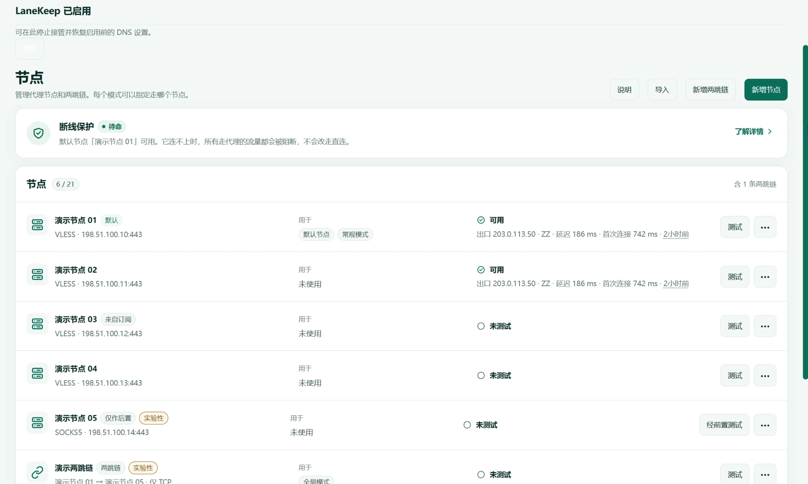
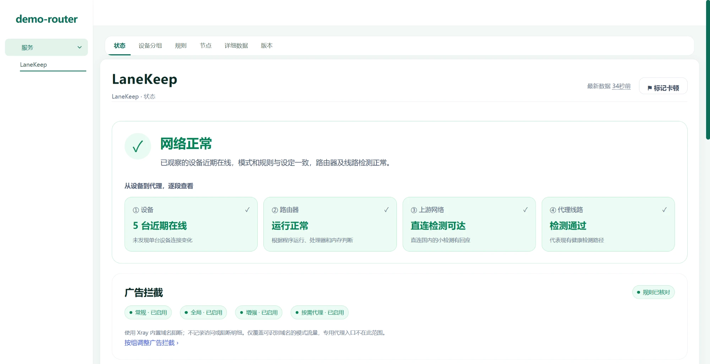
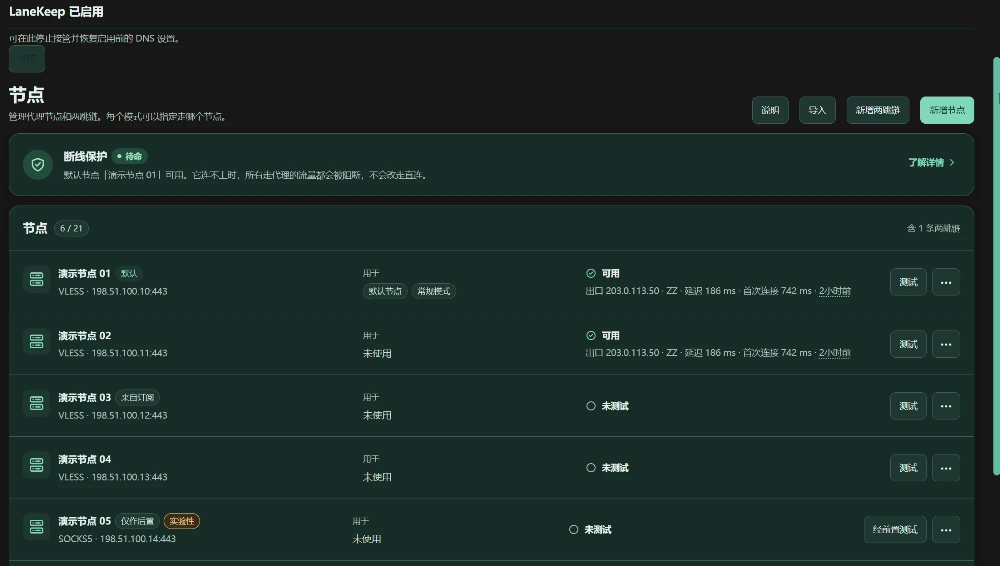

# LaneKeep

[English](README.en.md) · [防泄漏说明](docs/leak-protection.md) · [进阶说明](docs/notes.md)

OpenWrt 分流管理面板：按设备分规则，管理代理节点、DNS 路径和断线保护。

**v0.2.1 默认停用。安装、添加节点和保存设置都不会自动接管网络。** 选择默认节点后，必须在节点页单独确认“启用 LaneKeep”。

0.2.1 修正节点页断线保护总显示“未知”的问题和英文状态页标题；0.2.0 新增 IP 规则、规则等四页的界面整理和节点延迟测量 v3，见 [CHANGELOG](CHANGELOG.md)。从 0.2.0 或 0.1.0 可用 `apk add --upgrade` 覆盖安装（验收只覆盖停用实例的升级：0.2.1 验收从 0.2.0 升级，0.2.0 验收从 0.1.0 升级，见[验收边界](docs/audit/v0.2.1/acceptance.md#验证边界)）；降级回 0.1.0 前须先删除全部 IP 规则。



## 能做什么

| 模式 | 出厂预设 | 未匹配流量 |
|---|---|---|
| 常规（未分组设备的默认模式） | 已知国外分类代理；国内分类直连 | 直连 |
| 全局 | 保留私有域名和私有地址直连；其余使用代理，可添加自定义规则 | 代理 |
| 增强 | 国外分类及部分预设服务代理，国内分类直连 | 代理 |
| 按需代理 | 预设视频和服务分类代理，可添加需要代理的域名 | 直连 |

四个模式出厂都没有自定义规则、设备成员或节点。预设分类依赖规则数据库，不能等同于对所有网站的地理识别。自定义规则位于页面标出的插入位置；固定保护和部分私有地址规则优先。

- 每个模式可以选择自己的代理节点；未选择时继承默认节点。共享 DNS 和断线保护仍跟随默认节点。
- 域名、完整域名、关键词、公网 IPv4 地址 / 网段、固定广告域名分类规则；支持直连、代理、指定节点和阻断。广告拦截出厂未开启，可逐模式添加。IP 规则只命中识别不出域名的直接 IP 连接，不能使用两跳链，见[防泄漏说明](docs/leak-protection.md#自定义-ip-规则)。
- 两跳链：普通节点作为前置，SOCKS5 / HTTP 作为后置；链不能嵌套或成为默认节点。UDP 受组合能力和明确确认限制。
- 全局、增强、按需模式可使用 LAN 专用 SOCKS5 端口 **10811–10860**。仅允许对应模式的设备访问；常规模式不支持。专用入口有独立规则，不继承该模式全部域名规则。
- 可导出 Chrome / Edge 的 Windows 代理策略文件。下载不会修改电脑；自行导入会覆盖对应浏览器的同名策略，使用前请保留原值。
- 分享链接、Base64 列表、订阅与差异选择。订阅默认走默认节点；直连需要确认，不自动应用缓存节点。
- 支持的模型包括 VLESS、VMess、Trojan、Shadowsocks、Hysteria2、SOCKS5、HTTP。具体传输组合、试用状态及默认节点资格以能力表为准，见[进阶说明](docs/notes.md#协议与节点)。
- 状态、设备、规则、节点、详细数据和历史六页；聚合监控、24 小时曲线和有限的 30 天运行摘要。

| 状态页 | 深色节点页 |
|---|---|
|  |  |

## 防泄漏边界

启用后，所选 LAN 的 IPv4 透明流量进入固定规则：四个模式均处理 TCP/UDP 53，阻断 853、已知 DoH 分类、受保护的内部端口和未还原的 FakeIP 目标。**UDP 443 的覆盖并非各模式相同**：常规、全局、增强全面阻断；按需仅保护指定分类及自定义代理域名和 IP。

代理数据出口受默认节点的 DNS 健康门控约束。失败时关闭，不自动切换直连；其他模式选择的代理节点也受同一门控约束。探测有时间窗口，不是瞬时检测。直连业务仍依赖代理核心和 DNS，故障期间不保证可用。

IPv6 需要管理员预先关闭所选 LAN 的 IPv6 并保存为开机设置，本包不替你修改 IPv6 配置。启用检查不通过时拒绝接管；已启用后开机检查不通过时，局域网保持阻断而不是直连（这是 0.2.1 之后尚未发布的加固，0.2.1 安装包在这种情况下仍会直连，见 [CHANGELOG](CHANGELOG.md) 的 Unreleased 段）。WebRTC 是否暴露直连出口取决于实际规则；全局模式仍可存在显式直连例外。已知 DoH 分类不能覆盖任意应用自建 DoH。

Xray 的访问、错误和 DNS 日志关闭。监控保留数字、聚合类别和操作摘要，不记录访问网站或逐连接目标；节点配置和订阅凭据本身必须以受限权限保存在路由器上。完整机制、矩阵和限制见[防泄漏说明](docs/leak-protection.md)。

## 要求

- OpenWrt **25.12**、fw4 / nftables、LuCI；本次通用 APK 的生命周期测试平台是隔离的 25.12.6 x86_64 虚拟机，Xray 26.10.21。此前版本已有实体设备运行和六页浏览器验收记录；本通用 APK 在其他架构和实体设备上的安装、升级、卸载流程仍需单独验证。
- 路由器承担所选 LAN 的 IPv4 网关和 DHCP；该逻辑接口须有一个 IPv4 子网。默认选择 `lan`，网卡和地址从 OpenWrt 读取，不写死。
- 设备分组前先建立 DHCP 静态租约。所选 LAN 必须禁用 IPv6；不支持与其他透明代理共同争用相同端口、标记或路由表。
- 为 Xray、分类数据库、更新和历史记录留出足够空间；内存消耗取决于节点、连接和数据库，不沿用某台设备的内存数字作为最低要求。
- 浅色和深色面板样式由页面自身加载；Argon 是预览所用主题，不是必需依赖。

完整包依赖：`luci-base`、`rpcd`、`rpcd-mod-ucode`、`uhttpd-mod-ubus`、`xray-core`、`v2ray-geoip`、`v2ray-geosite`、`firewall4`、`nftables-json`、`kmod-nft-tproxy`、`kmod-nft-socket`、`ip-full`、`ucode`、`ucode-mod-fs`、`ucode-mod-uci`、`ucode-mod-ubus`、`ucode-mod-math`、`ucode-mod-socket`、`ucode-mod-struct`、`ucode-mod-digest`、`ca-bundle`、`curl`、`flock`、`coreutils-timeout`。内核模块的精确依赖由对应 OpenWrt 仓库解析。

## 安装、升级和卸载

从本仓库的 **Releases** 下载 APK 和对应 SHA256 文件。核对哈希后上传到自己的测试路由器。v0.2.1 是未签名的独立包，确认来源后才使用 `--allow-untrusted`。

```sh
sha256sum -c luci-app-lanekeep-0.2.1-r1.apk.sha256
apk update
apk add --allow-untrusted ./luci-app-lanekeep-0.2.1-r1.apk
```

安装前检查剩余空间：本次测试的依赖增量约 56 MiB，升级还需要暂存余量。依赖由系统当前 25.12 软件源安装；不要混用其他 OpenWrt 版本或内核的软件源。打开 **服务 → LaneKeep**。首次安装只准备本包文件、菜单和停用的启动入口，不创建流量接管表或策略路由、不改 DNS，也不开启断线保护。

升级时用新文件运行 `apk add --upgrade --allow-untrusted ./新版本文件.apk`。先保留设置和节点备份。已启用的实例会短暂停用、更新并按原启用状态恢复；停用实例保持停用。每版使用独立的 LaneKeep JS/CSS 路径，普通重新打开页面即可取得新资源。RPC 刷新后可能需要重新登录 LuCI。

```sh
apk del luci-app-lanekeep
```

卸载前停止本包服务，删除本包拥有的 nft 表（含启用期间的阻断表及其保存的副本；阻断表属于 0.2.1 之后尚未发布的加固，0.2.1 安装包没有）及策略路由，恢复启用前 DNS 字段。若期间其他程序修改过 DHCP 配置，只恢复仍由本包拥有的字段，保留外部改动。自行关闭的 IPv6 不会被包重新开启；APK 可能自动移除不再被需要的依赖包；LaneKeep 卸载脚本不主动删除其他应用。节点和用户修改的配置可能由 APK 作为配置文件保留，请在转交设备前自行检查和清理敏感数据。

## 开始使用

1. **添加节点**：粘贴分享链接或填写参数，检查改动并确认保存。此时网络保持原状。
2. **测试并设默认**：对目标节点测试，再选择“设为默认”。失败测试需要额外确认；设默认本身仍不启用接管。默认节点不能是链、SOCKS5 / HTTP 或未验证试用组合；当前保护链要求实际节点端点为 IPv4 地址。
3. **设备分组**：先在 OpenWrt 建立静态租约，再在设备页选择模式，分别检查并应用分组和规则。
4. **准备 IPv6**：关闭所选 LAN 的 IPv6 地址、RA 和 DHCPv6，并明确禁用该 LAN 设备的 IPv6。检查 `/proc/sys/net/ipv6/conf/<LAN设备>/disable_ipv6` 为 `1`；仅关闭 RA 不足以满足启用检查。持久化方法由自己的 OpenWrt 网络配置决定。
5. **明确启用**：在节点页点击“启用 LaneKeep”，阅读流量、DNS 与断线保护影响并确认。启用前会检查默认节点、接口、IPv6、保留表和路由冲突。
6. **检查状态**：等待健康探测完成，查看状态页；用自己的客户端验证实际分流、DNS 和 WebRTC。保护卡“未知”表示缺少可靠快照，不能当成已通过。

## 已知限制

- 不保证所有 WebRTC、未知加密 DNS、硬件、故障或重启场景都不泄漏。DNS 按共享保护路径解析，不随每个模式的独立节点改变。
- 切换默认节点或规则可能重启核心并中断连接。活动实例最多等待约 60 秒的新门控状态；失败尝试恢复旧配置，恢复仍失败时保持阻断，不承诺一定恢复连通。
- 不自动选择另一个节点。历史恢复可撤销所选操作及之后的整套设置，不只是某一行。
- 最多 21 条节点记录，链包含在内；历史指标编号可能先耗尽 96 项统计预算，链流量未单独采集。
- 英文界面仍可能显示原样的中文后端诊断。检测服务响应格式变化也可能导致节点测试失败，不等同于节点完全不可用。
- 节点“延迟”是同一条隧道上两次复用请求的较小值，“首次连接”含与节点握手；测速和出口查询分别访问 `www.gstatic.com` 与 `ipinfo.io`，口径见[进阶说明](docs/notes.md#节点测试)。

## FAQ

**断线保护触发后国内站点一定正常吗？** 不一定。数据门控针对代理出口，但直连业务仍依赖核心和 DNS。

**如何判断 DNS / WebRTC 结果？** 在客户端检查 [BrowserLeaks](https://browserleaks.com/webrtc) 和 [DNSLeakTest](https://www.dnsleaktest.com/)，结合实际模式和直连例外判读。常规模式国内分类走国内解析是设计行为，不应仅按结果所在国家判断泄漏。

**会自动测试或刷新订阅吗？** 订阅刷新由用户操作；健康探测在明确启用后持续运行。订阅缓存不会自动变成生效节点。

## 参与开发

使用 Python 3.9+ 启动纯演示预览（不会访问路由器）：

```sh
python tools/preview/serve.py
```

打开输出的本机地址。`?page=nodes&theme=dark&lang=en` 可选择页面、主题和语言。预览只模拟 RPC，JS/CSS 和页面初始化由同一构建工具生成，与安装包一致。

`root/` 是运行时源码和空出厂配置；`tools/build/` 生成版本化资源和 APK；`packaging/` 是生命周期脚本；`tools/preview/` 是演示工具；`tests/` 和 `docs/audit/` 保存可公开的验证方法与结果。离线检查运行 `python -X utf8 -m unittest discover -s tests -v`；隔离测试机上的检查见 [tests/target](tests/target/README.md)。

在 Linux 上使用带 `mkpkg` 的完整 apk-tools 3.x：`python3 tools/build/build-apk.py --apk /path/to/apk`。OpenWrt 目标机自带的精简 apk 通常没有打包子命令。也提供 OpenWrt 包 Makefile；版本分别由 `VERSION` 和 `RELEASE` 定义。修改版本后重新生成资源和包。

Issue 请包含设备型号、OpenWrt 版本、Xray 版本、出问题的页面、复现步骤、预期和实际结果。**不要粘贴节点地址、IP、UUID、密钥、密码、订阅链接或未脱敏配置。** 安全问题按 [SECURITY.md](SECURITY.md) 私下报告。

## 许可证

[GPL-3.0-only](LICENSE)。修改后再分发须遵守 GPLv3，并提供相应源代码。第三方组件和数据来源见 [THIRD_PARTY.md](THIRD_PARTY.md)。
